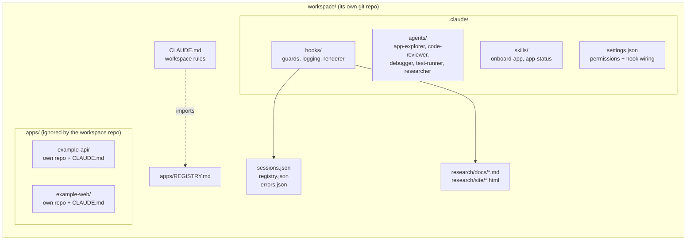
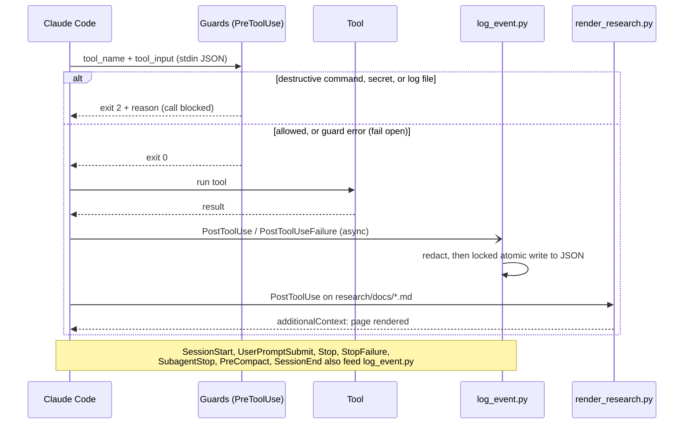

# Claude Team Harness

A template for a shared Claude Code workspace where a team manages several apps, with shared
agents, review standards, guard rails, usage logs, and a research library that all apply the
same way in every app.

[](https://github.com/cBoulio/claude-team-harness/actions/workflows/ci.yml)


Each app keeps its own git repo, stack, and `CLAUDE.md`. The workspace around them holds what
should be the same everywhere: how Claude explores, reviews, debugs, and tests code; which
commands and files are off limits; and a record of what the AI did. The hooks are plain Python
(standard library only) and run on Windows, macOS, and Linux.

I built this from the workspace I use day to day, generalized so another team can start from it.

## How it fits together





## Quick start

Requirements: Python 3.10+, git, and Claude Code.

**1. Create a workspace**

```bash
git clone https://github.com/cBoulio/claude-team-harness.git
python claude-team-harness/scripts/init.py ~/work/acme-workspace --name "Acme Platform"
```

This copies `template/`, fills in the workspace name and the Python command the hooks use
(`python` on Windows, `python3` elsewhere; override with `--python`), and runs `git init -b main`.
Use `--no-git` to skip git.

**2. Add an app**

```bash
cd ~/work/acme-workspace
python scripts/add-app.py example-api --repo https://github.com/<org>/example-api.git \
    --stack "Node.js, Postgres" --purpose "Public REST API"
python scripts/add-app.py example-worker --new --stack "Python" --purpose "Nightly jobs"
```

`--repo` clones into `apps/<name>/`; `--new` creates an empty repo with a starter `CLAUDE.md`.
Either way a row is added to `apps/REGISTRY.md`.

**3. First session**

```bash
claude
```

Then, inside Claude Code:

```text
/onboard-app example-api        map the app and write its CLAUDE.md
/app-status                     branch, uncommitted work, ahead/behind, open issues per app
```

After the session, `sessions.json` and `registry.json` exist in the workspace root. Edit the
"Team conventions" section of the workspace `CLAUDE.md` to match your team, and commit the
workspace repo so everyone gets the same setup.

## What's included

| Kind | Name | What it does |
|------|------|--------------|
| Agent | `app-explorer` | Maps an unfamiliar app: stack, entry points, commands, integrations, state. Read-only. |
| Agent | `code-reviewer` | Reviews a diff for correctness, security, and the app's own platform rules. Read-only. |
| Agent | `debugger` | Reproduces a failure, confirms the root cause, applies the smallest fix, re-runs tests. |
| Agent | `test-runner` | Runs an app's tests, lint, and typecheck; reports failures without flooding the chat. |
| Agent | `researcher` | Writes a sourced research dossier to `research/docs/`. |
| Skill | `/onboard-app` | Clone or copy an app in, map it, write its `CLAUDE.md`, add it to the registry. |
| Skill | `/app-status` | One table of every app's git state, registry status, and open issues. |
| Hook | `guard_commands.py` | PreToolUse on Bash/PowerShell. Blocks recursive deletes of root/home, force push, `reset --hard`, `git clean -f`, disk formatting, and piping downloads into a shell. |
| Hook | `protect_files.py` | PreToolUse on Edit/Write. Blocks edits to the log files, `.env` and key files, git internals, lockfiles, and any write whose content looks like a live credential. |
| Hook | `log_event.py` | Records sessions, tool usage, subagents, models, versions, tokens, and failures to JSON, with redaction. |
| Hook | `render_research.py` | Renders `research/docs/*.md` (front matter, tables, callouts) into a static HTML site with an index. |
| CLI | `log_issue.py` | `add`, `list`, `resolve` for the issue log in `errors.json`. |
| Script | `scripts/init.py` | Creates a workspace from the template. |
| Script | `scripts/add-app.py` | Clones or creates an app and adds its registry row. |

See a rendered research page: [`examples/research/site`](examples/research/site) (also published
from [`docs/`](docs) for GitHub Pages). See what the logs contain:
[`examples/logs`](examples/logs/README.md).

## How a team uses it

**Onboarding a new engineer.** They clone the workspace repo, run `add-app.py` for the apps
they work on (or clone them into `apps/` by hand), and start Claude Code at the workspace root.
They get the same agents, skills, guard rails, and per-app `CLAUDE.md` files as everyone else on
day one. `/app-status` gives them a map of what exists and what's in flight.

**Shared review standards.** The `code-reviewer` agent reads each app's `CLAUDE.md` and judges
code by that app's rules, then by a fixed checklist (correctness, security, platform rules,
missing tests). Changing what "reviewed" means is a pull request to one markdown file, and the
whole team picks it up on the next pull.

**Tracking what the AI did.** `registry.json` shows which tools, MCP servers, subagents, models,
and Claude Code versions are in use and where failures cluster by app. `sessions.json` gives
per-session counts and token usage. `errors.json` collects tool and API failures automatically
and anything someone logs with `log_issue.py`, so a flaky test noticed mid-session doesn't get
lost. The files are local to each machine; see [Limits](#limits).

**Research that persists.** When someone asks the `researcher` agent a question ("which vector
store should we use?"), the answer lands as a markdown dossier with sources and a verdict, and a
hook renders it to HTML. The `research/docs/` folder is committed, so the next person finds the
answer instead of asking again.

## Design decisions

**Apps as separate repos.** Each app keeps its own history, CI, access control, and release
cycle. The workspace repo ignores `apps/*` except the registry, so adding the workspace never
means restructuring an existing project, and an app can leave the workspace without surgery.
The cost is that cross-app changes are several commits in several repos, which is usually what
you want anyway.

**Hooks over instructions for what must always happen.** `CLAUDE.md` is guidance; the model
usually follows it, but not every time. Anything that must happen every time (don't force push,
don't touch secrets, log every tool call, re-render a changed dossier) is a hook, because hooks
run whether or not the model remembers.

**Fail-open hooks.** A bug in a logging hook must never stop someone's work. `log_event.py`
catches everything, writes the traceback to `.claude/hooks/hook-errors.log`, and exits 0. The
renderer never fails a tool call. The guards exit 2 only for a deliberate block; if they can't
parse their input they exit 0 and the normal permission flow decides. This is a tradeoff: a
broken guard lets a call through to the permission prompt instead of blocking it. The deny rules
in `settings.json` back up the most important cases.

**Redaction before write.** Tool inputs and error text are clipped and passed through secret
patterns before they reach disk, and prompt text is never stored at all, only counted. The
`protect_files.py` guard separately refuses to write credential-shaped strings into source files.

**Logs gitignored and edit-blocked.** The JSON logs describe one person's sessions on one
machine, so they stay out of git. Claude can read them but `protect_files.py` blocks direct
edits, so the record of what happened can't be rewritten by the thing it records. Issues go
through `log_issue.py`, which keeps ids, timestamps, and the summary consistent.

**Research as markdown, rendered to HTML.** Markdown diffs well, reviews well in a pull request,
and is easy for an agent to write. HTML is easier to read with a table of contents and callouts.
The renderer escapes raw HTML and drops unsafe links, because research text quotes untrusted
web content. It uses only the standard library, so it works without installing anything.

**Standard library only.** No `pip install` step stands between cloning the workspace and the
hooks working, on any OS with Python 3.10+.

## Limits

- Logs are per machine. There is no central collector; to aggregate across a team you'd ship
  the JSON files somewhere yourself.
- Redaction is pattern-based. It catches common credential formats, not every secret. Keep the
  logs local.
- Guards match command text with regular expressions. They stop common mistakes, not a
  determined bypass (for example, a destructive command built inside a script). Use Claude Code's
  permission modes and deny rules as the main control, with guards as a second layer.
- Token and model counts come from the session transcript format, which Claude Code can change.
  If it does, those fields stop updating; the rest of the logging keeps working.
- The markdown renderer covers what dossiers use (headings, lists, tables, code, callouts,
  links, emphasis), not all of CommonMark.
- `add-app.py` handles git URLs and new repos. Copying a local folder in is a manual step
  described in the `/onboard-app` skill.
- Tested on Windows, Ubuntu, Python 3.11 and 3.13 in CI. macOS is expected to work but isn't in
  the CI matrix.

## Development

```bash
python -m venv .venv
.venv/Scripts/python -m pip install "pytest>=8"   # .venv/bin/python on macOS/Linux
.venv/Scripts/python -m pytest
python scripts/render-examples.py                  # after changing the renderer or sample dossier
```

The tests create a workspace with `init.py` in a temp folder and run every hook as a subprocess
with real hook payloads: logging and redaction, fail-open on malformed input and unwritable
files, the issue CLI round trip, research rendering and its escaping, guard allow/deny cases,
and `add-app.py` cloning and creating apps.

## License

MIT. Copyright (c) 2026 Caleb Boulio.
